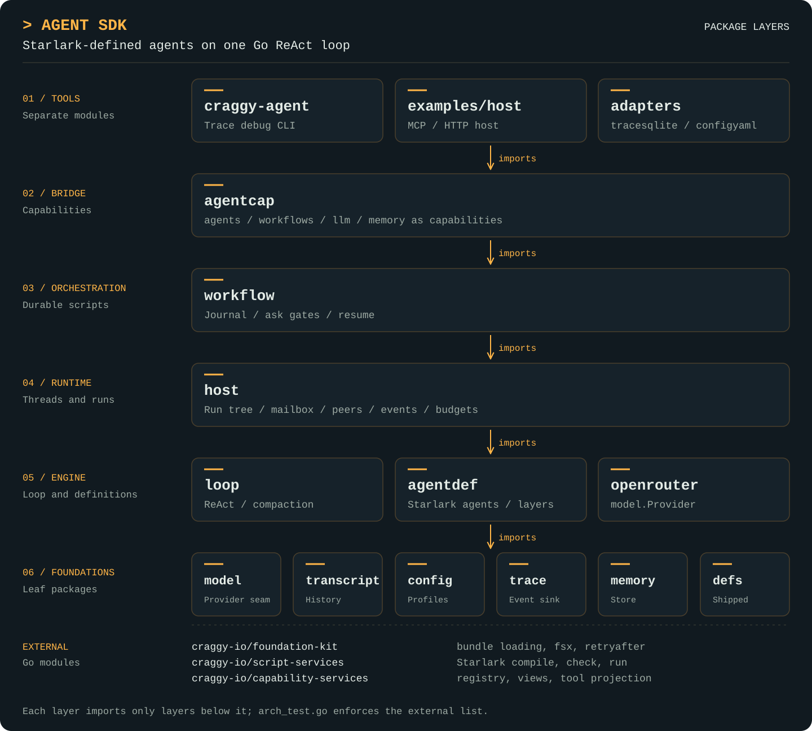

<picture>
  <source media="(prefers-color-scheme: dark)" srcset="docs/assets/craggy-wordmark-on-dark.svg">
  
</picture>

# Agent SDK

A Go library for building LLM agents and multi-agent workflows whose
definitions are Starlark scripts. The Go host owns the ReAct loop, budgets,
traces and tools; Starlark scripts define agents and compose them into
workflows. Adding a capability to the host registry makes it callable from
new scripts with no host changes.

The module is `github.com/craggy-io/agent-sdk`:

```sh
go get github.com/craggy-io/agent-sdk@latest
go install github.com/craggy-io/agent-sdk/cmd/craggy-agent@latest   # optional trace debugger
```

## Features

- **One ReAct loop:** [project, sample, classify, dispatch, settle](docs/loop.md)
  in Go, exposed to scripts as built-ins; provider-neutral behind
  [`model.Provider`](docs/model.md), with an [OpenRouter](docs/openrouter.md)
  implementation and [scripted test providers](docs/agenttest.md) included.
- **Agents and workflows in Starlark:** [definitions](docs/agentdef.md) run by
  [script-services](https://github.com/craggy-io/script-services); built-in
  definitions [ship embedded](docs/defs.md), and user and project definitions
  are bundles (folders with a `bundle.yaml`) loaded and hot-reloaded by
  [foundation-kit](https://github.com/craggy-io/foundation-kit); new
  definitions install at runtime behind an approval gate.
- **Durable workflows:** a [call-key journal](docs/workflow.md) in the
  append-only [trace](docs/trace.md) makes replay-from-top resume work across
  restarts, including human `ask` gates.
- **Capabilities:** managed by
  [capability-services](https://github.com/craggy-io/capability-services):
  register once, call from Starlark, LLM tools, MCP or HTTP. Agents,
  workflows, LLM sampling and [memory](docs/memory.md) are
  [themselves capabilities](docs/agentcap.md).
- **Multi-agent runtime:** [spawn, message, steer, interrupt and resume](docs/host.md)
  agents under one shared budget, with a live event stream over the trace.
- **No secrets in the library:** API keys and auth are host-supplied; live
  provider tests run only when explicitly enabled.

## Package architecture

<p align="center">
  <a href="docs/assets/agent-sdk-architecture.svg">
    
  </a>
</p>

## Packages

| Package | Role |
| --- | --- |
| `model` | Provider seam: requests, responses, usage, deltas, tool filters |
| `transcript` | Append-only conversation items, normalisation, invariants |
| `loop` | The ReAct loop: sampling, tool dispatch, compaction, budgets |
| `trace` | Append-only event sink with content-addressed blobs (`memory`, `query` subpackages; SQLite in `adapters/tracesqlite`) |
| `config` | Profiles, limits and layered resolution as Go values |
| `openrouter` | OpenRouter `model.Provider` implementation |
| `agenttest` | Scripted and chaos providers for tests |
| `agentdef` | Starlark agent definitions: load, extends chains, resolve |
| `host` | Runtime: threads, run tree, mailbox, peers, events, budgets |
| `workflow` | Durable Starlark workflows: journal, ask gates, resume |
| `memory` | Durable memory store exposed as capabilities |
| `agentcap` | Capability bridge: agents, workflows, LLM and memory in a registry |
| `defs` | The shipped definition bundles: built-in agents, skill and workflows |
| `cmd/craggy-agent` | Debug CLI over a trace database |
| `examples/host` | Runnable host wiring registry, MCP, HTTP and scripts |

See [docs/README.md](docs/README.md) for per-package guides,
[docs/design.md](docs/design.md) for the invariants code comments cite
as `§N`, [docs/host-example.md](docs/host-example.md) for the runnable host, and [AGENTS.md](AGENTS.md) for the integration guide.

## Quick start

```go
import (
    "github.com/craggy-io/agent-sdk/agentdef"
    "github.com/craggy-io/agent-sdk/config"
    "github.com/craggy-io/agent-sdk/defs"
    "github.com/craggy-io/agent-sdk/host"
    "github.com/craggy-io/agent-sdk/openrouter"
    tracemem "github.com/craggy-io/agent-sdk/trace/memory"
    "github.com/craggy-io/capability-services/registry"
)

func run(ctx context.Context) error {
    loader, err := agentdef.Open(ctx, agentdef.Options{
        Shipped: defs.Sources(), // built-in agents, skill and workflows
        Project: "res",          // optional: bundles replacing them by name
    })
    if err != nil { return err }

    r := registry.New() // tools the agents may call
    h, err := host.Open(ctx, host.Options{
        Config:   config.Defaults(),
        Provider: openrouter.New(os.Getenv("OPENROUTER_API_KEY")),
        View:     host.NewRegistryView(r.View(registry.All)),
        Defs:     loader,
        Trace:    tracemem.New(), // adapters/tracesqlite for durable runs
    })
    if err != nil { return err }
    defer h.Close()

    res, err := h.RunAgent(ctx, "assistant", "Summarise this repository")
    if err != nil { return err }
    fmt.Println(res.Text)
    return nil
}
```

Definitions are bundles. **Every definition folder needs a
`bundle.yaml`** listing each agent, skill and workflow; its `id` is the
name, and nothing is discovered from file names:

```yaml
apiVersion: craggy.io/bundle/v1
metadata: {id: agentsdk.project, version: 1.0.0}
contributions:
  - {id: reviewer, kind: agentsdk.agent@1, path: agents/reviewer.star}
  - {id: plan-review, kind: agentsdk.workflow@1, path: workflows/plan-review.star}
```

Layers contain independently identified bundles: shipped (`defs.Sources()`),
user (`UserDir`, where approved promotion installs individual bundles) and project.
Higher layers replace lower contributions by kind and name; same-layer conflicts
fail. Directory groups are discovered recursively, and all content is loaded by
foundation-kit's bundle pipeline. See [docs/agentdef.md](docs/agentdef.md).

An agent definition is a Starlark file declaring one agent:

```python
agent(
    name = "reviewer",
    extends = "base",
    profile = "deep",
    prompt = [
        {"review": "Review the material. Cite file and line."},
        {"replace": "conduct", "text": "Be strictly evidence-based."},
    ],
    tools = tools_filter(max_effect = "read-only"),
    loop = loop_spec(
        completion = "structured",
        output = schema.object({"verdict": schema.string(required = True)}),
    ),
)
```

A workflow composes agents and survives restarts:

```python
WORKFLOW = workflow(
    description = "Plan, approve, review.",
    input = {"text": schema.string(required = True)},
)

def run(input):
    plan = agent("assistant", task = "Plan: " + input.text)
    d = ask("approve", payload = {"plan": plan.text})
    if d.decision != "approve":
        return {"status": "rejected"}
    return agent("reviewer", task = plan.text)
```

## Development

Requires Go 1.27 or newer. Craggy dependencies:
`github.com/craggy-io/foundation-kit`,
`github.com/craggy-io/script-services` and
`github.com/craggy-io/capability-services`.

```sh
test -z "$(gofmt -l .)"
go vet ./...
go build ./...
go test ./...
go test -race ./...
for m in adapters/tracesqlite adapters/configyaml cmd/craggy-agent examples/host; do
  (cd $m && go vet ./... && go test ./...)
done
```

The nested modules depend on published versions of this module (no
`replace` directives): release the core first, then the adapters
(`adapters/<name>/vX.Y.Z` tags), then move `cmd/craggy-agent` and
`examples/host` to them. Prefer tags over pseudo-versions when you do. The adapters keep heavy dependencies (SQLite,
config YAML) out of the core module graph.

Live OpenRouter tests are skipped unless `OPENROUTER_API_KEY` is set and
`AGENT_SDK_LIVE=1`.
